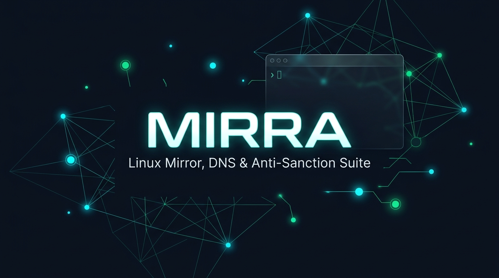

<p align="center">
  
</p>

# 🚀 Mirra — Automated Linux Mirror, DNS & Anti-Sanction Suite

<p align="center">
  <a href="https://github.com/Nzrmohammad/Mirra/actions/workflows/ci.yml"></a>
  
  
  
  
  <a href="https://t.me/Nzrmohammad"></a>
</p>

<p align="center">
  <b>Production-Grade, Zero-Bloat Mirror, Container Registry, Anti-Sanction DNS & Developer Ecosystem Orchestrator for Linux Servers.</b>
</p>

---

## 📖 Table of Contents
- [🎯 Why Mirra?](#-why-mirra)
- [⚡ Key Features](#-key-features)
- [🖥️ TUI & CLI Preview](#️-tui--cli-preview)
- [🏛 Project Architecture](#-project-architecture)
- [📦 Prerequisites, Supported Systems & Target Paths](#-prerequisites-supported-systems--target-paths)
- [🚀 Deployment & Quick Start](#-deployment--quick-start)
  - [Stage 1: Remote Execution (`curl | bash`) or Local Clone](#stage-1-remote-execution-curl--bash-or-local-clone)
  - [Stage 2: Interactive TUI Mode](#stage-2-interactive-tui-mode)
  - [Stage 3: Automated Non-Interactive Provisioning](#stage-3-automated-non-interactive-provisioning)
- [🛠️ Production Playbooks & Real-World Recipes](#️-production-playbooks--real-world-recipes)
- [🔄 Updating, Backup, Rollback & Clean Uninstall](#-updating-backup-rollback--clean-uninstall)
- [🔍 Troubleshooting & Sanction Diagnostics](#-troubleshooting--sanction-diagnostics)
- [⚙️ Complete CLI Reference](#️-complete-cli-reference)
- [🧪 Testing & Quality Assurance](#-testing--quality-assurance)
- [👨‍💻 Community & License](#-community--license)

---

## 🎯 Why Mirra?

Deploying and maintaining Linux servers behind regional sanctions, flaky upstream links, or slow international routes usually means debugging broken `apt` lists, Docker `403 Forbidden` errors, stalled `pip`/`npm`/`cargo` installs, or risking destructive overwrites of existing daemon configs.

| Common Server Problem | How Naive Scripts Fail | How Mirra Handles It Safely |
| :--- | :--- | :--- |
| **Slow or Dead Mirrors** | Blindly pick a hard-coded URL or ping-only check | Benchmarks mirrors **in parallel** via real HTTP status codes (`200`/`401`/`302`), rejects `403`/`502`/sinkholes, and probes APT freshness & download throughput |
| **Overwriting `daemon.json`** | Replace `/etc/docker/daemon.json` and wipe `log-driver`, `data-root`, or TLS keys | Performs **non-destructive JSON merging** (`jq` -> `python3` -> pure `awk` fallback) keeping all custom keys intact |
| **Broken 3rd-Party APT Repos** | Wipe all `.list`/`.sources` files or leave `apt-get update` broken | Inspects actual `apt-get update` failures to disable **only failing** files, and rewrites sanctioned Docker CE / Kubernetes / NodeSource / Postgres entries |
| **Root vs. Regular User Mismatch** | Configure NPM/Go/Cargo/Maven only for `/root` while devs build under `sudo` user | Resolves `$SUDO_USER` automatically via `run_as_target_user` and configures both system-wide (`/etc/*`) and user-level configs |
| **Stale Mirrors Over Time** | One-time setup silently degrades weeks later | Installs a daily **`systemd` Watchdog Timer** (`--enable-watchdog`) that health-checks active mirrors and auto-rotates dead endpoints with Telegram alerts |
| **Fear of Breaking Production** | No preview mode and manual, error-prone rollback | Supports full `--dry-run` diff previews and tracks every baseline file in `/var/backups/mirra/manifest.log` for 1-command `--restore-all` |

---

## ⚡ Key Features

### 🌐 Intelligent Network & Benchmarking Engine
- **Parallel HTTP-Verified Probing**: Concurrently benchmarks dozens of endpoints (`mirrors.json` fetched live from GitHub with instant `--offline` built-in fallback), validating real HTTP status codes (`200`, `206`, `301`, `302`, `307`, `308`, and `401` for Docker Hub `/v2/`).
- **APT Freshness & Real Throughput Measurement**: Inspects `Last-Modified` / `Date` headers on `Release` metadata (`synced Xh ago`) and measures real partial download throughput (`KB/s` or `MB/s`) on top-ranked mirrors.
- **Auto-Region Detection**: Detects `IRAN` vs. `GLOBAL` server routing automatically via GeoIP + live Docker Hub reachability heuristic.

### 📦 Multi-Distro OS Package Engine
- **Ubuntu & Derivatives** (`18.04`–`24.04+`): Supports both modern DEB822 (`/etc/apt/sources.list.d/ubuntu.sources`) and legacy `/etc/apt/sources.list`, including `arm64`/`armhf` ports repositories (`ubuntu-ports`).
- **Debian** (`10`–`13+`): Supports DEB822 (`/etc/apt/sources.list.d/debian.sources`) and legacy `sources.list`, auto-enabling `non-free-firmware` on Bookworm+ and dedicated `debian-security` mirrors.
- **Alpine, RHEL Family & Arch**: Native configuration for `/etc/apk/repositories` (`apk`), `/etc/yum.repos.d/*.repo` (`dnf`/`yum` for RHEL, Rocky, Alma, Fedora, CentOS), and `/etc/pacman.d/mirrorlist` (`pacman`).
- **Smart Sanctioned Third-Party APT Repair**: Rewrites `download.docker.com`, `pkgs.k8s.io`, `deb.nodesource.com`, and `apt.postgresql.org` to reachable mirrors without touching healthy repos.

### 🐋 Container Runtimes & Project Tooling
- **Docker, containerd & Podman**: Safely merges `"registry-mirrors"` into `/etc/docker/daemon.json`, writes `/etc/containerd/certs.d/docker.io/hosts.toml`, and configures `/etc/containers/registries.conf.d/99-mirra.conf`.
- **Project Dockerfile Patcher (`--patch-project`)**: Scans a project tree (`Dockerfile*`) and prefixes unqualified Docker Hub `FROM` statements (e.g., `FROM python:3.12-slim` or `FROM --platform=linux/amd64 node:20-alpine`) while leaving `scratch`, `$ARGS`, and custom registries (`ghcr.io`, `quay.io`) untouched.

### 💻 Full Developer Ecosystem Orchestration
- **Python**: System-wide `/etc/pip.conf`, user `~/.pip/pip.conf`, **`uv`** (`/etc/uv/uv.toml`), environment vars (`PIP_INDEX_URL`, `UV_DEFAULT_INDEX`), and **Conda / Mamba** (`~/.condarc`).
- **Node.js**: Unified registry setup across **`npm`**, **`yarn`**, **`pnpm`**, **`bun`** (`~/.bunfig.toml`), and **`NVM_NODEJS_ORG_MIRROR`**.
- **Systems & Backend Languages**: **Go** (`GOPROXY`), **Rust** (`~/.cargo/config.toml` sparse index + `RUSTUP_DIST_SERVER` / `RUSTUP_UPDATE_ROOT`), **PHP Composer**, **Java** (Maven `~/.m2/settings.xml` + Gradle `init.d/mirra.gradle`), **Ruby** (`gem`/`bundler`), **.NET** (`NuGet.Config`), **Homebrew / Linuxbrew**, and optional **GitHub HTTPS clone proxy** (`git config --global url.*.insteadOf`).

### 🛡️ Anti-Sanction DNS, NetworkManager, DoT/DoH, Selective Proxy & Kernel Tuning
- **DNS Benchmarking & Injection**: Tests **12** Iranian anti-sanction & gaming DNS profiles (**Shecan**, **403.online**, **Begzar**, **Radar**, **Electro / Alt**, **Shatel**, **Shelter**, **Beshkan**, **HostIran**, **Vanilla**, **DNSPro**) and **22** Global security/privacy/edge DNS profiles (**Cloudflare**, **Google**, **Quad9**, **OpenDNS / FamilyShield**, **AdGuard**, **NextDNS**, **Control D**, **Mullvad**, **CleanBrowsing**, **UncensoredDNS**, **DNS.WATCH**, **Comodo**, **Quad101**, **Verisign**, **Gcore**, **Yandex**) against actual `registry-1.docker.io` resolution + HTTP bypass verification.
- **Multi-Backend Linux DNS (`systemd-resolved` / `nmcli` / `resolv.conf`)**: Applies presets or `--dns-custom <IP1> [IP2]` via `systemd-resolved` drop-ins, **NetworkManager (`nmcli`)**, or `/etc/resolv.conf`, supports reverting to automatic DHCP (`--dns-dhcp`), displays active interfaces / `resolvectl dns`, and flushes local resolver caches (`--flush-dns`).
- **DNS-over-TLS (`--dot`) & DoH Guide**: Configures encrypted `DNSOverTLS=yes` drop-ins for Cloudflare, Quad9, Google, AdGuard, and NextDNS, plus includes a built-in DoH endpoint reference.
- **Global & Selective Proxy Routing**: Apply HTTP/HTTPS/SOCKS5 proxies across the entire system **or selectively only to Docker (`--docker-proxy`) or APT (`--apt-proxy`)** (ideal for local Cloudflare WARP `socks5://127.0.0.1:40000`).
- **Network Stack Hardening**: One-command IPv6 toggle + `Acquire::ForceIPv4`, **TCP BBR** (`fq` + `bbr`), automated Path **MTU probing**, and **NTP clock sync + CA certificate refresh**.

### 🤖 Watchdog Automation, Fleet Sync & Safety
- **Daily `systemd` Watchdog & Telegram Alerts**: Periodically checks active OS + Docker mirrors, rotates failed mirrors automatically, and dispatches alerts (with custom `--telegram-api` Cloudflare Worker URL or `--telegram-proxy` support).
- **Multi-Server Profile Sync (`--export` / `--import`)**: Benchmark once on a bastion host, export `mirra-profile.json`, and replicate across your fleet deterministically.
- **Machine-Readable Telemetry (`--json`)**: Outputs structured JSON for `--status` and `--diagnostics`.

---

## 🖥️ TUI & CLI Preview

<details>
<summary><b>📸 Click to expand Interactive Menu, Benchmarks &amp; Diagnostics Output</b></summary>

```text
  ███╗   ███╗██╗██████╗ ██████╗  █████╗
  ████╗ ████║██║██╔══██╗██╔══██╗██╔══██╗
  ██╔████╔██║██║██████╔╝██████╔╝███████║
  ██║╚██╔╝██║██║██╔══██╗██╔══██╗██╔══██║
  ██║ ╚═╝ ██║██║██║  ██║██║  ██║██║  ██║
  ╚═╝     ╚═╝╚═╝╚═╝  ╚═╝╚═╝  ╚═╝╚═╝  ╚═╝
   --- Automated Mirror, DNS & Anti-Sanction Helper (v2.0.0) ---

System & Mirror Overview:
  • OS:             Ubuntu 24.04.1 LTS (codename: noble, arch: amd64, pkg: apt)
  • Docker:         Installed (27.3.1)
  • Python Pip:     Installed (24.0)
  • Node.js NPM:    Installed (10.8.2) -> https://registry.npmmirror.com/
  • Golang:         Installed (go1.23.2) -> https://goproxy.cn,direct
  • Custom DNS:     Active (/etc/systemd/resolved.conf.d/99-mirra-dns.conf)

Please select an option:
  1) Configure OS Package Manager (ubuntu / apt)
  2) Configure Container Engines (Docker / containerd / Podman)
  3) Configure Dev Tools (Pip/uv, Node, Go, Rust, Composer, GitHub)
  4) Anti-Sanction DNS & System Proxy (Shecan, 403, Begzar, Proxy)
  5) Speed Test & Network Diagnostics
  6) One-Click Auto Config (Auto-Detect Region & Apply All)
  7) Maintenance, Profile Export/Import & Rollback
  0) Exit
```

**Multi-Layer Sanction Diagnostics (`mirra --diagnostics`):**
```text
[+] Running Multi-Layer Network & Sanction Diagnostics...

  1. DNS Resolution (google.com) ............... [OK]
  2. DNS Hijack Check (NXDOMAIN) ............... [CLEAN]
  3. ICMP Reachability (1.1.1.1) ............... [OK]
  4. Server Clock Skew ......................... [OK] (1s diff)
  5. Global HTTPS (google.com) ................. [RESTRICTED] (HTTP 000)
  6. Docker Hub Direct (registry-1.docker.io) .. [BLOCKED/SANCTIONED] (HTTP 403)
  7. PyPI Direct (pypi.org) .................... [OK] (HTTP 200)
  8. GitHub Direct (github.com) ................ [OK] (HTTP 200)

  Detected Optimal Profile: IRAN
```

</details>

---

## 🏛 Project Architecture

Mirra separates core utilities, benchmarking, package managers, container engines, language runtimes, DNS/proxy routing, profile portability, and watchdog automation into clean modules:

```text
Mirra/
├── mirra.sh                     # Entrypoint, CLI parser, curl|bash bootstrapper & TUI controller
├── mirrors.json                 # Unified registry (30 mirror/DNS categories; live fetch + local fallback)
├── lib/
│   ├── common.sh                # OS/arch detection, $SUDO_USER resolution, manifest backup & JSON parser
│   ├── network.sh               # Parallel HTTP-verified benchmarking, APT freshness, speed & diagnostics
│   ├── pkg.sh                   # Ubuntu, Debian, Alpine, RHEL/DNF, Arch & smart third-party APT fixer
│   ├── containers.sh            # Docker daemon.json merge, containerd hosts.toml & Podman config
│   ├── devtools.sh              # Pip/uv/Conda, NPM/Yarn/pnpm/Bun/NVM, Go, Rust, Composer, Ruby, NuGet, Java
│   ├── dns_proxy.sh             # Anti-Sanction DNS, DoT, Selective Proxy, BBR, IPv6, Path MTU & NTP
│   ├── profile.sh               # Portable server profile export & deterministic import
│   └── automation.sh            # Daily systemd watchdog, Telegram alerting & Dockerfile FROM patcher
├── tests/
│   └── test_mirra.sh            # Automated sandboxed Bash unit & syntax test suite
└── .github/workflows/
    ├── ci.yml                   # JSON lint, ShellCheck, unit tests & multi-distro Docker CI matrix
    └── mirror-health.yml        # Weekly scheduled endpoint availability probe
```

### Execution, Safe Merge & Backup Topology

```text
 ┌───────────────────────────────────────────────────────────────────────────────┐
 │                         mirra.sh (CLI / Interactive TUI)                      │
 │   • Loads local lib/*.sh or auto-bootstraps modules when piped via curl       │
 │   • Supports --auto, --dry-run, --yes, --offline, --json, --restore-all       │
 └───────────────┬───────────────────────────────┬───────────────────────────────┘
                 │                               │
                 ▼                               ▼
 ┌───────────────────────────────┐ ┌─────────────────────────────────────────────┐
 │   mirrors.json + network.sh   │ │           common.sh Safety Layer            │
 │ • Live GitHub fetch + fallback│ │ • Snapshot baseline files before edit to    │
 │ • Parallel curl HTTP check    │ │   /var/backups/mirra/manifest.log           │
 │ • Auto-detect IRAN vs GLOBAL  │ │ • Non-destructive output in --dry-run mode  │
 └───────────────┬───────────────┘ └─────────────────────────────────────────────┘
                 │
                 ▼
 ┌───────────────────────────────────────────────────────────────────────────────┐
 │                      Target Configuration Subsystems                          │
 │  • pkg.sh        -> /etc/apt/sources.list(.d), /etc/apk/repositories, dnf     │
 │  • containers.sh -> /etc/docker/daemon.json, containerd/certs.d, podman       │
 │  • devtools.sh   -> /etc/pip.conf, /etc/uv/uv.toml, npm/go/cargo/m2/gradle    │
 │  • dns_proxy.sh  -> /etc/systemd/resolved.conf.d/, sysctl.d/, /etc/profile.d/ │
 └───────────────────────────────────────────────────────────────────────────────┘
```

---

## 📦 Prerequisites, Supported Systems & Target Paths

| Subsystem | Supported Targets | Target Configuration Path(s) | Notes |
| :--- | :--- | :--- | :--- |
| **Shell & Core** | `Bash 4.3+`, `curl`, `awk`, `sed` | — | Pure-`awk` JSON parsing & floating-point math; **`python3` is not required**. |
| **APT** | Ubuntu `18.04`–`24.04+`, Debian `10`–`13+` | `/etc/apt/sources.list.d/ubuntu.sources`, `debian.sources`, `/etc/apt/sources.list` | Auto-detects DEB822 vs. legacy format and `amd64` vs. `arm64`/`armhf` ports. |
| **APK / DNF / Pacman** | Alpine, RHEL, Alma, Rocky, Fedora, Arch | `/etc/apk/repositories`, `/etc/yum.repos.d/*.repo`, `/etc/pacman.d/mirrorlist` | Auto-detected via `/etc/os-release`. |
| **Containers** | Docker, containerd, Podman | `/etc/docker/daemon.json`, `/etc/containerd/certs.d/docker.io/hosts.toml`, `/etc/containers/registries.conf.d/99-mirra.conf` | Preserves all pre-existing keys inside `/etc/docker/daemon.json`. |
| **Python & Conda** | `pip`, `uv`, `poetry`, `conda`, `mamba` | `/etc/pip.conf`, `~/.pip/pip.conf`, `/etc/uv/uv.toml`, `~/.condarc`, `/etc/profile.d/mirra-devtools.sh` | Configures both root and `$SUDO_USER` environments. |
| **Node / Go / Rust / JVM** | `npm`, `yarn`, `pnpm`, `bun`, `nvm`, `go`, `cargo`, `rustup`, `mvn`, `gradle` | `~/.npmrc`, `~/.bunfig.toml`, Go env, `~/.cargo/config.toml`, `~/.m2/settings.xml`, `~/.gradle/init.d/mirra.gradle` | Uses Cargo sparse index (`rsproxy-sparse`) + NVM/Rustup env exports. |
| **PHP / Ruby / .NET / Brew** | `composer`, `gem`, `bundle`, `dotnet`, `brew` | Composer global config, `.gemrc`/Bundler, `~/.nuget/NuGet/NuGet.Config`, `mirra-devtools.sh` | Automatically skips runtimes not installed (except declarative NuGet/Java/Conda configs when chosen). |
| **DNS, Proxy & Kernel** | `systemd-resolved`, `resolv.conf`, `sysctl`, `timesyncd` | `/etc/systemd/resolved.conf.d/99-mirra-dns.conf`, `/etc/profile.d/mirra-proxy.sh`, `/etc/sysctl.d/99-mirra-*.conf` | Selective Docker/APT proxies live cleanly in dedicated drop-in files. |

> [!IMPORTANT]
> Non-destructive commands (`--help`, `--version`, `--status`, `--diagnostics`, `--export`, `--patch-project`, and `--dry-run`) work **without root privileges**. Applying system-level mirror, DNS, or kernel changes requires `root` / `sudo`.

---

## 🚀 Deployment & Quick Start

### Stage 1: Remote Execution (`curl | bash`) or Local Clone

**Option A — One-line remote run** (automatically bootstraps modules into a clean temporary directory):
```bash
curl -fsSL https://raw.githubusercontent.com/Nzrmohammad/Mirra/main/mirra.sh | sudo bash
```

**Option B — Clone, grant execute permissions (`chmod +x`), and run or install globally:**
```bash
git clone https://github.com/Nzrmohammad/Mirra.git
cd Mirra
chmod +x mirra.sh lib/*.sh tests/*.sh
sudo ./mirra.sh

# Optional: install 'mirra' command globally to /usr/local/bin/mirra
sudo ./mirra.sh --install
```

### Stage 2: Interactive TUI Mode

Once installed globally, launch the interactive dashboard anytime:
```bash
sudo mirra
```

### Stage 3: Automated Non-Interactive Provisioning

Ideal for freshly provisioned VPS instances, Cloud-Init, Ansible, and CI/CD runners:
```bash
# Auto-detect server region (Iran vs Global) and configure OS, Docker, DevTools & DNS
sudo mirra --auto --yes

# Preview every file change safely without modifying disk
sudo mirra --auto iran --dry-run

# Configure individual subsystems
sudo mirra --pkg iran
sudo mirra --docker iran
sudo mirra --devtools iran
sudo mirra --dns iran
```

---

## 🛠️ Production Playbooks & Real-World Recipes

<details>
<summary><b>📘 Recipe 1: Fresh Iran Production Server Setup (Fastest Mirrors + BBR + NTP)</b></summary>

```bash
sudo mirra --sync-time                 # Fix TLS clock skew & update CA certificates first
sudo mirra --auto iran --yes           # Configure fastest OS, Docker, DevTools & DNS
sudo mirra --bbr enable                # Enable TCP BBR congestion control
sudo mirra --ipv6 disable              # Disable broken IPv6 routes & force APT IPv4
```

</details>

<details>
<summary><b>🐋 Recipe 2: Selective Proxy Only for Docker or APT (e.g., Local Cloudflare WARP SOCKS5)</b></summary>

Route **only** `docker pull` / `apt-get` traffic through a local SOCKS5/HTTP tunnel without redirecting the rest of your server:

```bash
# Route only Docker daemon pulls via local WARP / proxy
sudo mirra --docker-proxy socks5://127.0.0.1:40000

# Or route only APT package downloads
sudo mirra --apt-proxy http://127.0.0.1:7890

# Clear selective proxies later
sudo mirra --docker-proxy clear
sudo mirra --apt-proxy clear
```

</details>

<details>
<summary><b>🤖 Recipe 3: Enable Daily Self-Healing Watchdog + Telegram Alerts</b></summary>

Mirra can monitor your active OS and Docker mirrors daily via `systemd`, automatically rotate dead mirrors, and alert you via Telegram (including through a Cloudflare Worker proxy URL if `api.telegram.org` is blocked):

```bash
sudo mirra --notify-telegram "<BOT_TOKEN>" "<CHAT_ID>" --telegram-api "https://your-worker.workers.dev"
sudo mirra --enable-watchdog IRAN

# Run an immediate manual watchdog verification pass
sudo mirra --run-watchdog
```

</details>

<details>
<summary><b>🚚 Recipe 4: Multi-Server Fleet Replication & Project Dockerfile Patching</b></summary>

Benchmark once, then clone identical mirror/DNS settings onto every other node, and rewrite legacy `Dockerfile` bases inside your repositories:

```bash
# On reference server:
mirra --export fleet-profile.json

# Copy fleet-profile.json to target nodes and apply deterministically:
sudo mirra --import fleet-profile.json

# Rewrite unqualified Docker Hub FROM lines inside a project folder:
mirra --patch-project /opt/my-app
```

</details>

---

## 🔄 Updating, Backup, Rollback & Clean Uninstall

Every system file modified by Mirra is first backed up to `/var/backups/mirra/` and indexed in `/var/backups/mirra/manifest.log`:

```bash
# Update Mirra scripts and mirrors.json to the latest GitHub commit
sudo mirra --update

# Roll back ALL OS, Docker, DevTools, DNS, proxy, BBR & IPv6 changes to original baseline
sudo mirra --restore-all

# Completely remove Mirra CLI, shared modules, watchdog units & /etc/mirra
sudo mirra --uninstall
```

---

## 🔍 Troubleshooting & Sanction Diagnostics

Run Mirra's multi-layer diagnostic probe before making manual network changes:

```bash
# Human-readable network, DNS hijack, clock skew & endpoint report
mirra --diagnostics

# Machine-readable JSON telemetry for monitoring scripts
mirra --status --json
mirra --diagnostics --json
```

> [!TIP]
> - **BROKEN `apt-get update` ON THIRD-PARTY REPOS**: Open interactive Section `1` (`OS Package Manager`) -> Option `6` (**Smart fix broken third-party APT sources**) to inspect real `apt-get` errors and disable only failing `.list`/`.sources` files safely, or Option `7` to switch `download.docker.com` / `pkgs.k8s.io` / `deb.nodesource.com` / `apt.postgresql.org` to mirrors.
> - **TLS CERTIFICATE ERRORS ON `curl` OR `apt`**: Run `sudo mirra --sync-time` to sync NTP (`ir.pool.ntp.org`) and refresh `/etc/ssl/certs`.
> - **DNS OVERRIDDEN BY ISP/PROVIDER**: Use `--dot cloudflare` (`systemd-resolved` DNS-over-TLS) or verify hijack checks via `--diagnostics`.

---

## ⚙️ Complete CLI Reference

| Flag | Argument | Default | Description |
| :--- | :--- | :--- | :--- |
| `--auto` | `[iran \| global \| auto]` | `auto` | Auto-detect region (or force profile) and configure OS, Docker, DevTools & DNS. |
| `--pkg` | `<iran \| global>` | `iran` | Benchmark and apply OS package manager mirror (`apt`, `apk`, `dnf`, `pacman`). |
| `--docker` | `<iran \| global>` | `iran` | Benchmark and safely merge Docker `registry-mirrors` into `/etc/docker/daemon.json`. |
| `--devtools` | `<iran \| global>` | `iran` | Configure Pip/uv, NPM/Yarn/pnpm/Bun, Go, Cargo/Rustup, Composer, Conda & Java. |
| `--dns` | `<iran \| global \| dhcp>` | `iran` | Apply Anti-Sanction Iranian DNS, Global DNS, or revert to DHCP (`systemd-resolved` / `nmcli` / `resolv.conf`). |
| `--dns-custom` | `<IP1> [IP2]` | — | Validate and apply custom IPv4 primary (and optional secondary) DNS servers. |
| `--dns-dhcp` | — | — | Remove Mirra DNS overrides and revert NetworkManager / `systemd-resolved` to automatic DHCP DNS. |
| `--flush-dns` | — | — | Flush local DNS resolver cache (`resolvectl`, `systemd-resolve`, `nscd`, `nmcli`). |
| `--dot` | `<cf \| quad9 \| google \| adguard \| nextdns \| off>` | `cloudflare` | Configure DNS-over-TLS (`DNSOverTLS=yes`) via `systemd-resolved`. |
| `--proxy` | `<URL>` | — | Set Global HTTP/HTTPS/SOCKS5 proxy across `/etc/profile.d/`, APT, Docker & Git. |
| `--docker-proxy` | `<URL \| clear>` | — | Set or clear a selective proxy **only** for Docker (e.g., `socks5://127.0.0.1:40000`). |
| `--apt-proxy` | `<URL \| clear>` | — | Set or clear a selective proxy **only** for APT. |
| `--clear-proxy` | — | — | Remove all Mirra proxy configurations and reload services. |
| `--ipv6` | `<disable \| enable>` | `disable` | Disable IPv6 + force APT IPv4, or re-enable IPv6. |
| `--mtu` | `<VALUE \| auto>` | `auto` | Auto-probe optimal Path MTU or apply an explicit MTU on the default interface. |
| `--bbr` | `<enable \| disable>` | `enable` | Enable or disable TCP BBR congestion control via `sysctl`. |
| `--sync-time` | — | — | Sync NTP clock (`ir.pool.ntp.org`) and refresh `ca-certificates`. |
| `--export` | `<FILE>` | `mirra-profile.json` | Export active mirror, DNS & IPv6 configuration to a portable JSON profile. |
| `--import` | `<FILE>` | — | Apply an exported Mirra JSON profile deterministically without re-benchmarking. |
| `--patch-project` | `<DIR>` | `.` | Rewrite unqualified Docker Hub `FROM` images inside project `Dockerfile*` files. |
| `--enable-watchdog` | `[REGION]` | `AUTO` | Enable daily `systemd` timer (`mirra-watchdog.timer`) to auto-heal unreachable mirrors. |
| `--disable-watchdog` | — | — | Disable and remove the Mirra watchdog `systemd` service and timer. |
| `--run-watchdog` | — | — | Execute a single mirror health check and rotation pass immediately. |
| `--notify-telegram` | `<TOKEN> <CHAT_ID>` | — | Save Telegram Bot credentials for watchdog rotation alerts. |
| `--telegram-api` | `<URL>` | `https://api.telegram.org` | Optional custom Telegram Bot API / Cloudflare Worker relay URL. |
| `--telegram-proxy` | `<URL>` | — | Optional proxy URL for Telegram alert delivery (`socks5://127.0.0.1:40000`). |
| `--diagnostics` | — | — | Run DNS, NXDOMAIN hijack, clock skew, ICMP, Docker Hub, PyPI & GitHub probes. |
| `--status` | — | — | Display detected OS, architecture, installed runtimes, DNS & proxy state. |
| `--restore-all` | — | — | Restore all backed-up configs from `/var/backups/mirra/manifest.log`. |
| `--install` | — | — | Install `mirra` CLI globally to `/usr/local/bin/mirra` and `/usr/local/share/mirra/`. |
| `--update` | — | — | Pull latest `mirra.sh`, `lib/*.sh`, and `mirrors.json` from GitHub. |
| `--uninstall` | — | — | Uninstall Mirra binary, shared modules, and watchdog timers. |
| `-y`, `--yes` | — | `false` | Skip interactive confirmation prompts. |
| `--dry-run` | — | `false` | Preview exact commands and generated files without modifying the system. |
| `--json` | — | `false` | Emit machine-readable JSON for `--status` and `--diagnostics`. |
| `--offline` | — | `false` | Skip remote GitHub `mirrors.json` fetch and use local/built-in lists. |
| `-v`, `--version` | — | — | Print installed Mirra version and exit. |
| `-h`, `--help` | — | — | Show full CLI help reference and exit. |

---

## 🧪 Testing & Quality Assurance

Mirra includes a self-contained, sandboxed Bash test suite verifying syntax, JSON parsing, CLI flags, DEB822 config generation, Docker `daemon.json` key preservation, containerd/Podman, Cargo/Conda/Maven/Gradle/NuGet/Homebrew env outputs, third-party APT rewriting, IPv6/BBR/DoT/Selective Proxy generation, profile export/import, Watchdog/Telegram configs, and Dockerfile patching:

```bash
# Make scripts executable and run the unit & syntax test suite
chmod +x mirra.sh lib/*.sh tests/test_mirra.sh
./tests/test_mirra.sh

# Run ShellCheck linting
shellcheck -x -S warning mirra.sh lib/*.sh tests/*.sh
```

GitHub Actions workflows in [ci.yml](.github/workflows/ci.yml) run `jq` JSON validation, `shellcheck`, unit tests, and live dry-run checks across **Ubuntu 22.04**, **Ubuntu 24.04**, **Debian 12**, and **Alpine 3.20**, while [mirror-health.yml](.github/workflows/mirror-health.yml) monitors endpoint health weekly.

---

## 👨‍💻 Community & License

- **Author**: Mohammad
- **Telegram Channel**: [@Nzrmohammad](https://t.me/Nzrmohammad)
- **License**: Released under the **MIT License**
